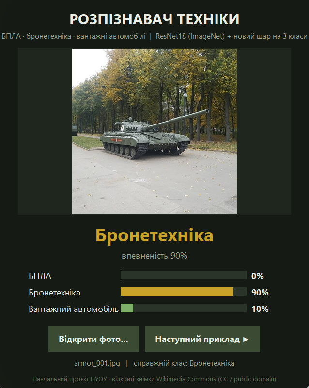
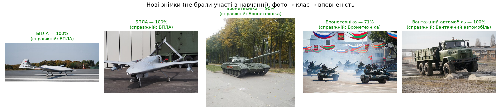
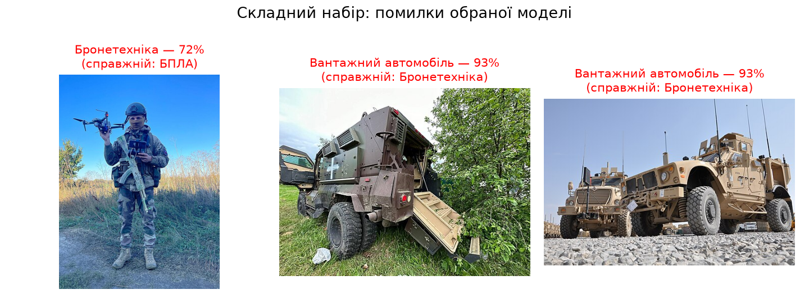

# Практична робота 4.13 · Варіант 1. Класифікатор трьох типів техніки

Навчальний застосунок відносить фотографію до одного з трьох класів — **БПЛА**, **бронетехніка**, **вантажний автомобіль** — і показує впевненість. В основі — готова модель **ResNet18**, донавчена методом transfer learning.



## Модель, дані, адаптація

| | |
|---|---|
| **Готова модель** | ResNet18, попередньо навчена на ImageNet-1k — `torchvision.models.resnet18(weights=IMAGENET1K_V1)` ([PyTorch Hub](https://pytorch.org/vision/stable/models/generated/torchvision.models.resnet18.html)) |
| **Що змінено** | фінальний шар `fc` 512→1000 замінено новим `fc` 512→3; порівняно режими **A** — навчається лише новий шар (1 539 параметрів, 0,01 %) і **B** — новий шар + розморожений блок `layer4` (75 % параметрів, lr 1e-4) |
| **Дані** | 135 відкритих знімків Wikimedia Commons (CC / public domain, автори й ліцензії — `data/credits.csv`); після ручного відбору 99 (`data/rejected.csv` — що відкинуто і чому): 20 навч. + 4 валід. на клас, 27 — тест |
| **Складний набір** | 24 знімки техніки інших типів (квадрокоптери, Bayraktar Akıncı, БТР-80, БМП-1, MRAP, Unimog, Iveco, ГАЗ-66) — `data/challenge/` |

## Результати

| Режим | Валідація | Тест (27) | Складний набір (24) |
|---|---:|---:|---:|
| A. Лише новий шар `fc` | 92 % | 93 % | 71 % |
| **B. `fc` + розморожений `layer4`** (обрано) | **100 %** | **100 %** | **88 %** |

Навчання обох режимів — ≈ 2 хв на CPU ноутбука, без GPU.



### Помилки


* **MRAP MaxxPro / M-ATV → «вантажний автомобіль», 93 %.** У навчальній вибірці бронетехніка лише гусенична (танки) — модель засвоїла «колеса + кабіна = вантажівка». Зсув розподілу даних; висока впевненість на помилці — найнебезпечніший випадок.
* **Солдат із квадрокоптером → «бронетехніка», 72 %.** Дрон займає малу частку кадру, переважають камуфляж і зброя.
* Режим A на тесті помиляється двічі (танк Т-64 у парку → «вантажівка» 48 %, KrAZ на полігоні → «бронетехніка» 42 %): без донавчання глибоких шарів модель частково орієнтується на фон.

## Висновок
* **Переваги:** 60 навчальних фото й 2 хв на CPU замість тисяч знімків і GPU — ознаки форм і контурів уже вивчені на 1,2 млн знімків ImageNet.
* **Обмеження:** малий тест (100 % ≠ безпомилковість), серії схожих кадрів у вибірці, немає класу «інше», колісна броня плутається з вантажівками, малі об'єкти погано розпізнаються.
* **Оцінка якості:** точність і матриця помилок на відкладеному тесті + окремий складний набір + аналіз впевненості на помилках. Застосунок позначає прогнози з впевненістю < 70 % як такі, що потребують перевірки оператором.

## Структура і запуск
```
app.py                         застосунок «Розпізнавач техніки» (tkinter): фото → клас → впевненість
4.13_vehicle_classifier.ipynb  звіт-ноутбук з результатами
scripts/fetch_images.py        збір відкритих знімків (Wikimedia Commons API)
scripts/train.py               донавчання ResNet18 (режими A і B)
scripts/challenge.py           перевірка на складному наборі
scripts/make_figures.py        графіки; scripts/predict.py — класифікація з командного рядка
models/resnet18_vehicles.pt    фінальна модель (режим B)
results/                       метрики (metrics.json, challenge.json) і графіки
4.13_presentation.pptx         презентація (2 слайди)
```
```bash
pip install -r requirements.txt
python app.py                              # застосунок
python scripts/predict.py фото.jpg         # класифікація з командного рядка
python scripts/train.py                    # повторити навчання (дані — data/clean)
```
Windows: `run_app.bat` — запуск застосунку подвійним кліком.

Дані — лише відкриті знімки з публічних джерел; матеріали з обмеженим доступом не використовувались.
