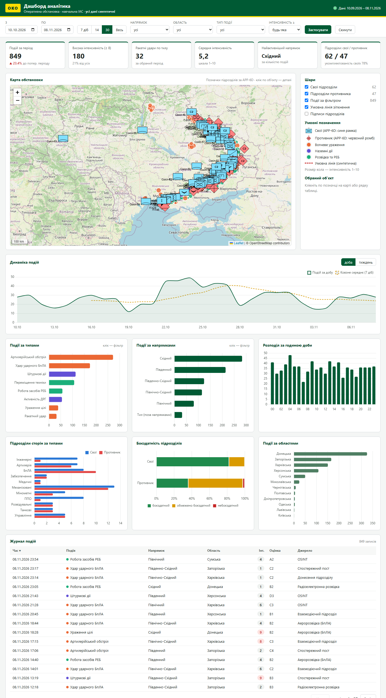

# Даш борд аналітика 09.11. «ОКО»: дашборд аналітика з картою обстановки

```
PostgreSQL  →  Python (FastAPI)  →  Web-дашборд (HTML/CSS/JS: Chart.js + Leaflet/OpenStreetMap + milsymbol)
```

Завдання (з дошки): **Postgres** — створити БД, заповнити синтетичними даними, надати `.sql`;
**Python** — FastAPI; **Web-дашборд** — оформлення за брендбуком, графіки, карта з умовними знаками
(OpenStreetMap + milsymbol).



## Що зроблено

| Частина | Реалізація |
|---|---|
| БД | 6 таблиць + представлення `v_events` ([db/schema.sql](db/schema.sql)): довідники `regions`, `directions`, `event_types`; `units` (підрозділи з кодом умовного знака APP-6D), `events` (події обстановки), `frontline_points` (умовна лінія) |
| Дані | [db/seed.py](db/seed.py): 109 підрозділів (свої й противника), 1537 подій за 60 діб, 19 точок умовної лінії. Генерація відтворювана (`--seed 42`) |
| `.sql` для здачі | **[db/oko_dashboard.sql](db/oko_dashboard.sql)**: схема й усі дані одним файлом; [db/data.sql](db/data.sql) містить лише INSERT-и |
| API | [api/main.py](api/main.py): FastAPI, сирий SQL (psycopg2), лише параметризовані запити, білий список для сортування |
| Дашборд | [web/](web/): фільтри, 6 KPI, карта, 7 графіків, журнал подій із сортуванням і пагінацією |

### Умовні знаки
Позначки підрозділів будує бібліотека **milsymbol** за 20-значним кодом **APP-6D (SIDC)** з поля `units.sidc`.
Код визначає належність (свої — синя прямокутна рамка, противник — червоний ромб), ешелон (рота, батальйон,
бригада) і тип: механізовані 121102, танкові 120500, розвідувальні 121300, артилерія 130300, мінометні 130800,
ППО 130100, БпЛА 121900, інженерні 140700, управління 110000 (з ознакою штабу), забезпечення 163400,
медичні 161300. Усі коди перевірено функцією `isValid()` у milsymbol.

Знаки побудовано за стандартом НАТО APP-6D. Якщо за наказом № 140 ЗСУ потрібні інші кольори чи шифри,
достатньо змінити функцію `sidc()` у `seed.py` (код знака зберігається в БД, а дашборд лише його відображає).

### Брендбук
Кольори з заготовки викладача (практична 5.5, «відповідно до брендбуку ЗСУ»): темно-зелений `#005a34`
(шапка, кнопки, одновимірні графіки) і жовтий `#ffdd00` (акцентна смуга, логотип). Кольори сторін на
графіках узгоджено з умовними знаками: свої сині, противник червоний.

### Дашборд
- **Фільтри**: період (і кнопки 7/14/30 діб, «Весь»), напрямок, область, тип події, мінімальна інтенсивність.
  Кліком по стовпчику графіків «за типами» чи «за напрямками» вмикається відповідний фільтр, повторний клік його знімає.
- **KPI**: кількість подій і зміна до попереднього періоду такої ж тривалості, висока інтенсивність (≥ 8), ракетні удари
  по тилу, середня інтенсивність, найактивніший напрямок, кількість підрозділів сторін і укомплектованість своїх.
- **Карта** (OpenStreetMap): підрозділи (знаки APP-6D, розмір залежить від масштабу), події (колір означає групу,
  розмір — інтенсивність), умовна лінія; шари вмикаються окремо. Клік по об'єкту відкриває картку з деталями
  (для підрозділу показано SIDC і укомплектованість).
- **Графіки**: динаміка подій (доба/тиждень, ковзне середнє за 7 діб), розподіл за типами, напрямками, областями й
  годинами доби, сили сторін за типами підрозділів, боєздатність сторін.
- **Журнал подій**: сортування за стовпцями; клік по рядку наближає карту до події.

У даних навмисно закладено **ескалацію на Східному напрямку 22–27.10.2026**: її видно на графіку динаміки,
а KPI за останні 30 діб показує зростання до попереднього періоду.

## Запуск

Потрібні PostgreSQL (разом із Command Line Tools) і Python 3.10+.

### Windows: подвійний клік по `ЗАПУСК.bat`
- **Перший раз** файл запускає налаштування ([scripts/setup_windows.ps1](scripts/setup_windows.ps1)). Воно запитає пароль
  користувача `postgres` (введення приховане) і створить `.env`, базу `oko_dashboard`, `.venv` та дані.
- **Далі** файл одразу запускає сервер ([run.py](run.py)), і через кілька секунд браузер сам відкриває **http://localhost:8020**.
  Якщо сервер уже працює, лише відкриється вкладка.
- **Зупинка:** закрийте чорне вікно.

Перегенерувати дані: `powershell -ExecutionPolicy Bypass -File .\scripts\setup_windows.ps1 -Reseed`.

### Вручну
```powershell
python -m venv .venv; .\.venv\Scripts\Activate.ps1
pip install -r requirements.txt
Copy-Item .env.example .env          # вписати USER і PASSWORD
psql -U postgres -c "CREATE DATABASE oko_dashboard;"
python db\seed.py                    # схема + дані (або: psql -U postgres -d oko_dashboard -f db\oko_dashboard.sql)
uvicorn api.main:app --port 8020
```
Відкрити http://localhost:8020 (дашборд) і http://localhost:8020/docs (Swagger API).
Перевірка: `python scripts\smoke_test.py`.

> **Не відкривайте `web/index.html` подвійним кліком.** Сервери OpenStreetMap блокують тайли для сторінок `file://`
> («Access blocked»), а API без запущеного сервера недоступне. Якщо сервер працює, сторінка сама перейде на http://localhost:8020.
>
> Для карти й бібліотек (CDN) потрібен інтернет. FastAPI сам віддає сторінку, тому окремий веб-сервер не потрібен.
> Якщо `psql -f` не бачить файл через кирилицю в шляху, передайте його через перенаправлення: `psql ... < db\oko_dashboard.sql`.

## API

Фільтри подій (необов'язкові): `from`, `to` (YYYY-MM-DD, включно), `region`, `direction`, `event_type`, `min_intensity` (1–10).

| Ендпоїнт | Відповідь |
|---|---|
| `GET /api/health` | `{status}` |
| `GET /api/filters` | списки областей, напрямків, типів подій і підрозділів, межі дат |
| `GET /api/kpi` | показники для карток, `delta_pct` до попереднього періоду |
| `GET /api/trend?group=day\|week` | часовий ряд, пропуски доповнено нулями |
| `GET /api/distribution/{types\|directions\|regions\|categories}` | `[{label, value, avg_intensity}]` |
| `GET /api/hourly` | 24 значення за годинами доби |
| `GET /api/events/geo` | точки подій для карти |
| `GET /api/events?page&page_size&sort&order` | журнал подій з пагінацією |
| `GET /api/events/{id}` | повний запис події |
| `GET /api/units?affiliation&region&direction&unit_type` | підрозділи з SIDC і координатами |
| `GET /api/units/summary` | кількість і укомплектованість за типом і стороною, розподіл за станом |
| `GET /api/frontline` | точки умовної лінії |

## Обмеження
- Дані повністю синтетичні: назви підрозділів, координати, події й лінія зіткнення вигадані й наближені.
- Підрозділи показано на одну дату, тому фільтр періоду на них не діє, а область і напрямок діють.
- Тайли OpenStreetMap беруться з публічного сервера, що прийнятно лише для навчального використання.
